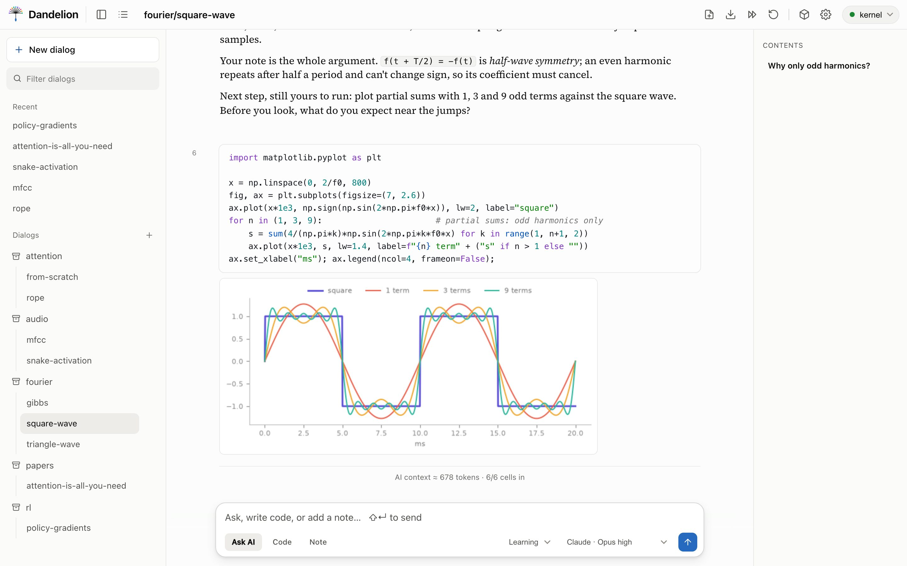
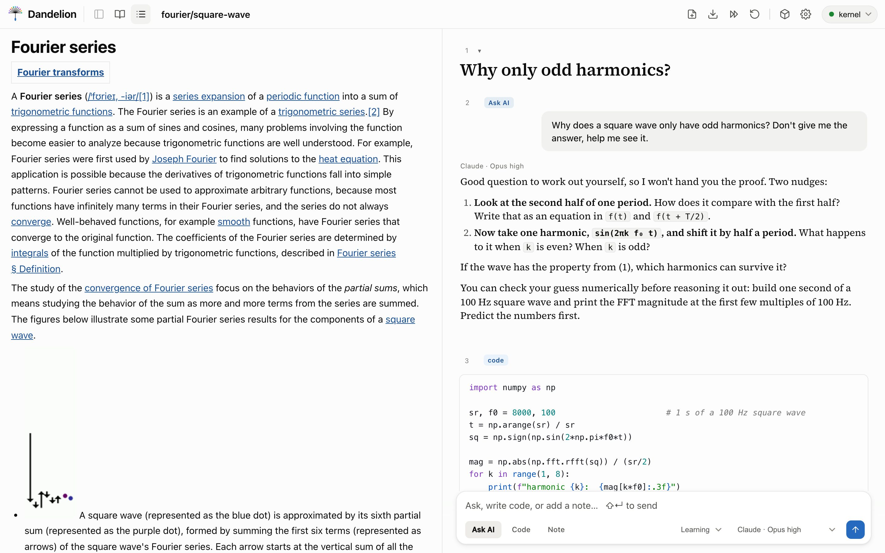

<p align="center">
  <picture>
    <source media="(prefers-color-scheme: dark)" srcset="site/assets/logo-dark.svg">
    
  </picture>
</p>

<p align="center">
  <a href="https://github.com/slegroux/dandelion/actions/workflows/ci.yml"></a>
  
  
  
  
  <a href="https://slegroux.github.io/dandelion/"></a>
  <a href="https://slegroux.github.io/sisyphe/"></a>
</p>

<p align="center">
  <a href="https://slegroux.github.io/dandelion/">Landing page</a> ·
  <a href="#quick-start">Quick start</a> ·
  <a href="#a-first-dialog">A first dialog</a> ·
  <a href="docs/GUIDE.md">Guide</a> ·
  <a href="docs/GUIDE.md#reading-papers-and-web-pages">Papers</a> ·
  <a href="docs/GUIDE.md#building-a-python-library-from-your-dialogs">Libraries</a>
</p>

<p align="center"><em>A local-first notebook that teaches. It hints. You run the code.</em></p>

<p align="center">
  <picture>
    <source media="(prefers-color-scheme: dark)" srcset="site/assets/shot-dark.jpg">
    
  </picture><br>
  <em>The learner plotted the partial sums; the AI explains the overshoot they found.</em>
</p>

Dandelion is a notebook where the AI is a thinking partner, not a ghostwriter. You
work in small steps, writing and running every cell yourself, and the AI asks a
guiding question or gives a hint when you need one. It looks like the Claude desktop app, runs on
your laptop, and switches to a remote GPU from a dropdown without changing how you
work.

## Why Dandelion

- **The AI hints; you run the code.** In learning mode, the default, an answer is a
  nudge, not the finished solution. When you ask, it can edit a cell you can see
  ("fix cell 3"), but it never runs a cell, and by default it can't write files or
  work off-screen.
- **A real notebook underneath.** Code runs in a persistent Python kernel, with
  completion from the live namespace, inline plots and DataFrames, linkable cells and
  Jupyter keys. The AI sees the cells above your question, so "why is this slow?"
  gets a real answer.
- **Yours, wherever it runs.** Notebooks, papers and libraries live in
  `~/.config/dandelion`, never in git, and the front end loads nothing from a CDN. The
  same notebook runs against your laptop or an H100 through an SSH tunnel.

## Quick start

You need [uv](https://docs.astral.sh/uv/) and [just](https://github.com/casey/just)
(`brew install uv just`).

```bash
git clone https://github.com/slegroux/dandelion.git && cd dandelion
uv sync --extra kernel --extra paper --extra web   # the app, the kernel's numpy/torch stack, PDF + web readers
just start                                         # kernel on :5055, UI on http://localhost:8000
```

`just stop` stops both, and `just app` builds a double-clickable `Dandelion.app`.
The LED in the top-right should be **green**: the UI has reached the kernel and code
runs for real. **Amber** means it fell back to an in-memory demo; `just doctor`
tells you why.

Then choose how Ask AI reaches a model, in **⚙ Settings**:

| Route | You need | Billed |
|---|---|---|
| **Claude subscription** (Pro / Max) | the `claude` CLI, signed in (`claude auth login`; [make it last](docs/GUIDE.md#signing-in-to-claude)) | your plan |
| **ChatGPT subscription** (Codex) | the `codex` CLI, signed in (`codex login`) | your plan |
| **Claude API** or **GLM** | an API key, pasted in Settings | per token |

## A first dialog

A dialog is a column of cells: **notes** (markdown), **code**, and **Ask AI**
prompts. Here is the loop, end to end.

**1. Write code and run it.** Variables persist between cells, as in Jupyter.

```python
import numpy as np
sr, f0 = 8000, 100
t = np.arange(sr) / sr
sq = np.sign(np.sin(2 * np.pi * f0 * t))     # one second of a 100 Hz square wave
```

**2. Ask, and get a nudge.** Put `` $`expr` `` in a prompt and the AI receives its
live value, computed fresh each time you ask:

> Why does a square wave only have odd harmonics? Don't give me the answer.
> My signal is `` $`sq.shape` `` samples long.

It answers with a hint and a check you can run, then leaves the next step to you.

**3. Let it edit, when you ask.** Every cell has a number in its gutter. "Vectorise
the loop in cell 4" rewrites that cell in place, and the new code waits there until
you press Run.

**4. Read a paper beside your notebook.** Click **📄** and paste
`arxiv.org/abs/1706.03762`: the PDF becomes structured text with equations, tables
and figures. Highlight a passage, click **→ Notebook**, and it arrives as a note
with an empty code cell below it for your version.

<p align="center">
  <br>
  <em>The reading panel on the left, the lesson beside it.</em>
</p>

**5. Ship what you learned.** Tag cells, from any dialog, into a Python package:

```python
#| export audiolib:layers        # this cell goes to library `audiolib`, module `layers`
class Conv1d: ...
```

```bash
uv run python -m dandelion.cli library build audiolib ./audiolib   # nbdev tangles it into a package
```

Click **Use in kernel**, and `import audiolib` works in any cell. Each generated
function links back to the cell you wrote it in.

## Features

| | |
|---|---|
| **[Editable cells](docs/GUIDE.md#editable-cells)** | Rendered by default, click to edit; headings fold into sections |
| **[Linked cells](docs/GUIDE.md#link-to-any-cell)** | `#_<id>` links within and across dialogs; the AI can cite cells too |
| **[Live completion](docs/GUIDE.md#code-completion)** | From what you've actually run, via jedi |
| **[Live values in prompts](docs/GUIDE.md#inject-live-values-into-a-prompt)** | `` $`df.shape` `` sends the real number |
| **[Context you can see](docs/GUIDE.md#the-ai-sees-the-notebook)** | Per-cell token counts; mute a cell to drop it, pin one to keep it |
| **[Three modes](docs/GUIDE.md#ai-modes--learning--concise--standard)** | learning, concise, standard |
| **[Cell edits, not an agent](docs/GUIDE.md#the-ai-can-edit-cells)** | Visible, in-notebook edits only; Write, Edit and Bash denied |
| **[Rich output](docs/GUIDE.md#rich-output)** | Matplotlib, `_repr_html_` and `_repr_png_`, inline |
| **[Jupyter keys](docs/GUIDE.md#keyboard-shortcuts-jupyter-style)** | Command and edit modes, `j`/`k`, `a`/`b`, `dd`, `z` |
| **[Papers and web pages](docs/GUIDE.md#reading-papers-and-web-pages)** | marker for PDFs, trafilatura for articles, or one section at a time |
| **[Cells into a library](docs/GUIDE.md#building-a-python-library-from-your-dialogs)** | Cross-dialog modules built with nbdev, with links back to the source cells |
| **[Saved and portable](docs/GUIDE.md#your-work-is-saved)** | Rolling backups, corrupt-file recovery, `just backup` / `just restore` |
| **Export** | Any dialog as `.ipynb` or markdown |

## Laptop or H100

A target is just the server URL the client points at, defined in
[`targets.yaml`](targets.yaml). For a remote GPU, run the bundled kernel server there
and tunnel it back. The URL stays on localhost, and the port never touches the
public internet:

```bash
uv run python -m dandelion.cli up h100        # open the SSH tunnel
uv run python -m dandelion.cli doctor h100    # DNS, port, token, route: exactly what's broken
```

Then switch targets from the dropdown in the top bar. Code runs on the bundled
kernel server by default; with the `solveit` extra, Dandelion can instead connect to a
SolveIt server through Answer.AI's `solveit_client`. See
[the guide](docs/GUIDE.md#connecting-to-a-solveit-server).

## Development

```bash
just test     # the suite runs offline: no server, subprocess or network
just lint
just dev      # kernel + UI in the foreground; Ctrl+C stops both
```

| Path | What it is |
|---|---|
| `dandelion/app.py` | The FastHTML UI: server-side rendering, htmx swaps |
| `dandelion/client.py` | One `connect()` over the bundled kernel, `solveit_client` and an in-memory mock |
| `server/kernel_server.py` | The kernel server: execution, rich output, completion |
| `dandelion/claude_cli.py`, `codex_cli.py` | Ask AI over your Claude or ChatGPT subscription |
| `site/` | The [landing page](https://slegroux.github.io/dandelion/) |

> **Renamed from Pappus** (and before that, SolveIt Sidekick). On first start,
> Dandelion moves your data from `~/.config/pappus` to `~/.config/dandelion` and
> leaves a link at the old path; converted papers keep their cache. `PAPPUS_*` and
> `SIDEKICK_*` settings still work as their `DANDELION_*` equivalents. Notebook code
> that imported `pappus.*` modules now imports `dandelion.*`.
